# FoamCut Workbench


A FreeCAD External Workbench for creating G-code for 4 and 5 axis CNC foam cutting machines.

Originally it was based on a set of macros written by Andrei Bezborodov (HardRock) - member of the FreeCAD community. His idea was to build a 5 axis foam cutter and use FreeCAD as a platform to produce output for this machine. Since he had no time to continue development, I decided to step in. Hopefully our effort will be appreciated.

So far there are many limitations, but I'm working on fixes.
If you want to contribute to this project - you are highly welcome!
Enjoy!

## Installation

### Automatic Installation via Addon Manager (Recommended)

- Open Tools > Addon Manager

- Search for FoamCut and click install.

<details><summary>Expand for details regarding Manual installation</summary>

### Manual Installation via Git

Linux:

```bash
cd ~/FreeCAD/Mod/ 
git clone https://github.com/Shkolik/Foamcut.git
```

Windows:

```cmd
cd %APPDATA%\FreeCAD\Mod 
git clone https://github.com/Shkolik/Foamcut.git
```

### Manual Installation via Zip

- Go to https://github.com/Shkolik/Foamcut
- Click on Code > Download ZIP
- Extract content of ZIP archive to your Mod directory

Linux:

```bash
~/FreeCAD/Mod/
```

Windows:

```cmd
%APPDATA%\FreeCAD\Mod 
```

</details>

When you restart FreeCAD, "FoamCut" workbench should now show up in the [workbench dropdown list](https://freecadweb.org/wiki/Std_Workbench).

## Video Tutorial

Quick workflow example:
[FoamCut workflow](https://youtu.be/15t2KHbIPVY)

Old tutorials (using macro), but workflow is the same (in Russian).
[ЧПУ пенорезка на 5 осей. Подготовка задания в FreeCAD.](https://youtu.be/TuBmqCTIS20?si=CNeAytixMs9086Nn)

## Example file

[Example file to play with workbench](Examples/Example.FCStd)

## Tools

###  Init Machine

Creates the Job object and opens the Job settings task panel. The panel groups every machine and process setting into pages (machine geometry, foam block, travel, axis mapping, feed rates, wire, kerf compensation, homing/parking and G-code). Values use the preferred unit system; dependent settings appear when their option is enabled (for example the homing positions once "Enable homing" is checked). All objects in the Job are rebuilt when the panel is closed with OK, and Cancel restores the previous setup (or removes a freshly created Job). Double-click the Job to edit the settings again. The Job itself cannot be picked in the 3D view: its machine graphics are drawn inline and are never painted in the selection color (selecting the Job shows only a bounding box, and opening the panel clears the selection). To turn off machine graphics, uncheck the corresponding checkbox in Properties -> View.

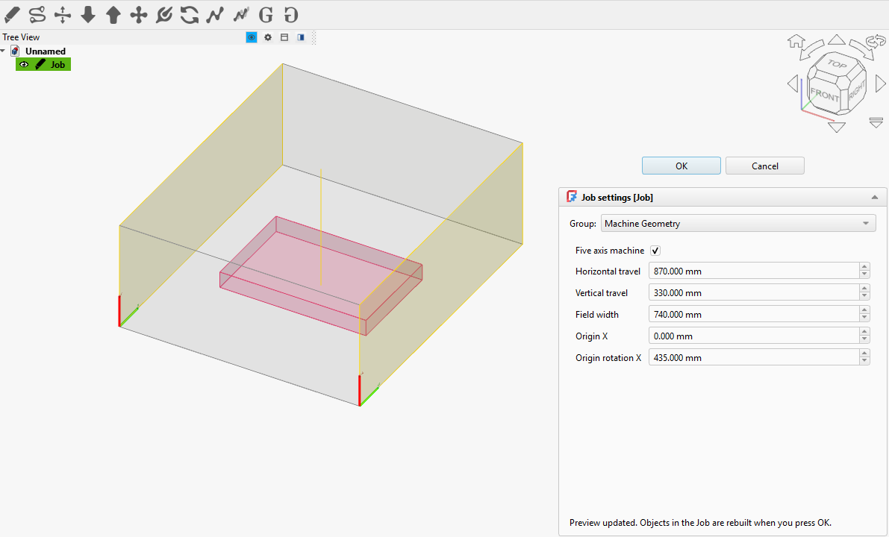

###  Create path

Creates a path from 2 given opposite edges. Opposite faces are also supported - the command will try to find opposite edges and create a path for each edge pair.


###  Create projection

Creates a projection path from a selected single edge, multiple edges or a face. Projection is basically an emulation of a 2 axis machine with a 4 axis one. It can be used for preparing foam blocks, cutting "hershi-bar" wings or decorative signs.
Projection and Path objects cannot be mixed in the same route. The command will create a projection for each edge.

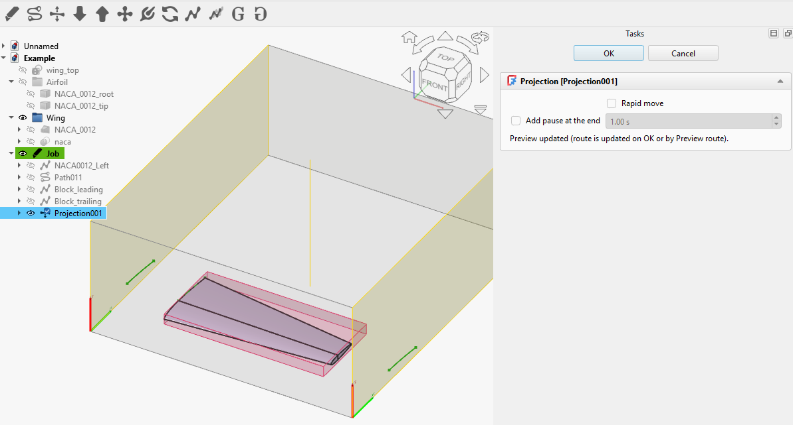

###  Create move path

Creates a path from the selected vertex in the specified direction.


###  Join

Creates a path between 2 selected vertices. Used to join 2 movements or to create a back path when cutting spars or inner pockets.


###  Enter

Creates an enter path from the safe height to the selected vertex. Supports lead-in that is proportional to the path that owns the entry point. Lead-in is helpful for entering the foam at the exact speed and temperature where it matters the most.

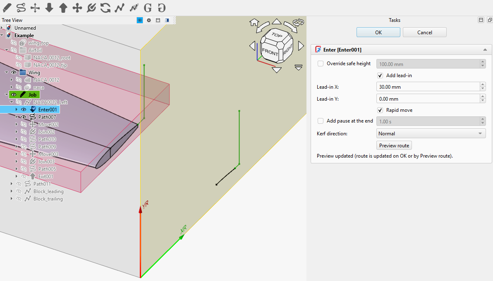

###  Exit

Creates an exit path to the safe height from the selected vertex. Supports lead-out. The idea is the same as lead-in for enter.

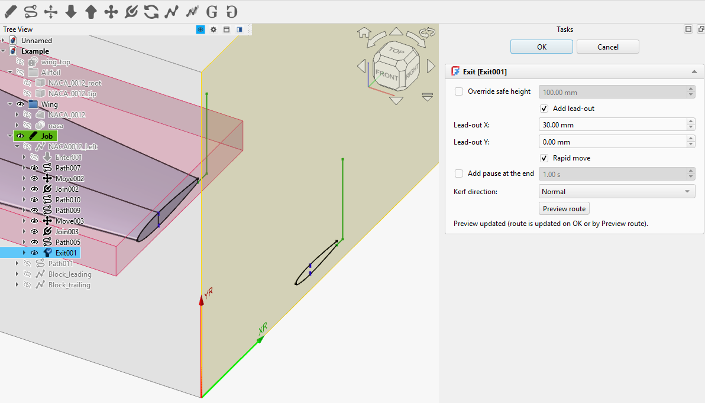

###  Rotation

Rotates the selected body around the 5th axis. It has its own shape that can be used in all operations. The shape is synchronized with its source.


###  Route

Creates a cutting route from selected paths and rotations. Objects should be selected in the right order before executing the command.
Kerf compensation supports 3 modes:

- None - the wire follows the exact path. Not very useful in real life, but fast to recompute. Default mode when a route is created.
- Uniform - both plane paths have the same offset (Kerf compensation) from the original path. The resulting part will never be exact since the wire speed is different on different parts of the route. The only exception is when the left and right paths are identical.
- Dynamic - the offset is scaled in relation to the wire speed over the given part of the route. That, in theory, lets the machine cut an exact part. Especially useful when cutting tapered parts. Compensation degree can be used to dial the proportion calculations - sometimes helpful on highly tapered and thin parts, since foam gets denser as it melts, which makes the proportion non-linear. In most cases 1.0 is what you want.

Kerf direction can be specified for each object (except Rotation, Path and Projection) independently or for the whole route.

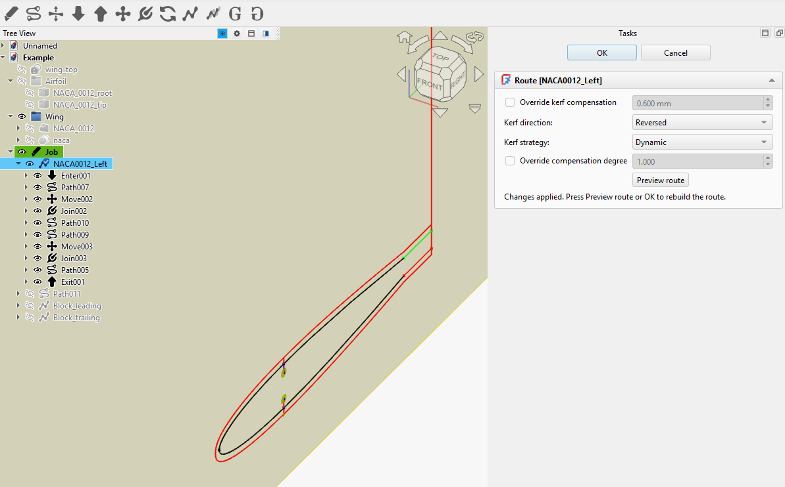

###  Duplicate route

Creates a parametric clone of the selected route and opens a task panel to place and/or mirror it. The clone follows all changes of the source route (paths, kerf compensation, pauses, feed overrides). The panel sets a Y (block length) and Z (block height) offset relative to the source, mirrors the cut horizontally (YZ) by swapping the wire planes like Mirror GCODE does, and can mirror it vertically (XY) about the middle of the foam block. In XY mode the plunge moves always stay at safe height and lead-in/lead-out are rebuilt from the mirrored entry/exit point, so their approach angle stays correct. Rotation angles are reversed for any mirror. Double-click a clone to edit it again. Only original routes can be duplicated - a clone cannot be cloned.

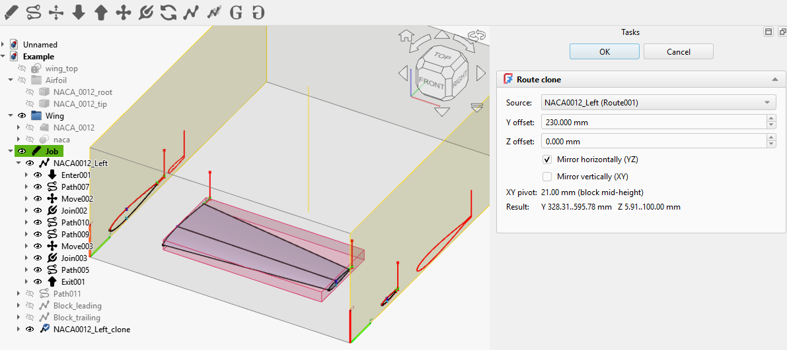

###  Generate Gcode

Generates G-code and saves it to the specified file.

###  Mirror Gcode

Mirror the selected G-code file around the YZ plane. Useful for cutting symmetrical pieces like wing consoles. At the moment there is no validation or changing of metadata in the resulting files - be careful using this command. De-facto obsolete command - if you have the source file with a route, just use "Duplicate route" instead, it has visual confirmation and follows all the settings of the machine profile. The only scenario to use the Mirror command is when the source file isn't available and you only have a G-code file in hand.

## Machine configuration

### Machine geometry

Physical layout of the machine.
"Origin X" is used to set the machine to operate in positive, negative or both spaces.
"Origin rotation X" - the rotation axis is always in the middle between the 2 planes; the only lever is how far from the origin it sits.

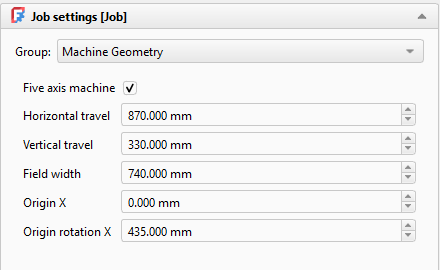

### Foam block

Foam block is mostly visual (for now) and lets you position the workpiece correctly.
Its size and position are also used in the resulting G-code preamble and in a duplicate route.

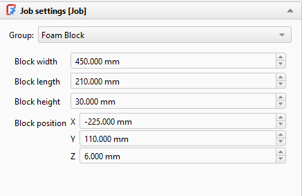

### Travel

- Safe height - height from where enter will plunge down, exit will plunge up and travel between routes happens. Should be free of foam/obstacles - all travels at this height are rapids and the wire is turned off.
- Pause duration - default pause duration. Almost every object lets you put a pause at its end to let the wire catch up before a sharp turn or to melt a groove. Can be overridden per object.

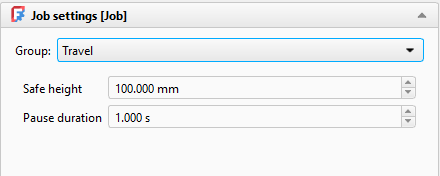

### Axis mapping

Workbench to real machine axis mapping. The default layout is XYZAB, but any other mapping can be used. X1Y1 - left plane, X2Y2 - right plane.

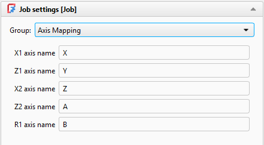

### Feed rate

Default feed rates.

- Cut - usually translates to the G01 command
- Move - rapid travel, usually G00
- Rotate - rotation speed. Controllers usually use its value as degree/minute.

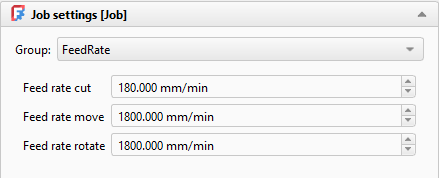

### Wire

Wire related settings. They make sense when your machine drives the wire from G-code.

- Min power - default wire power used in most cases.
- Max power - used for dynamic wire power. The controller will never output more than this value.
- Dynamic wire power - lets the program adjust wire power depending on wire length, but since the wire has thermal inertia it proved to be a gimmick and will be deprecated soon.
- Wire stretch verification - produces a warning if a particular move will need a wire length that is more than physically possible. Not blocking, at least for now.

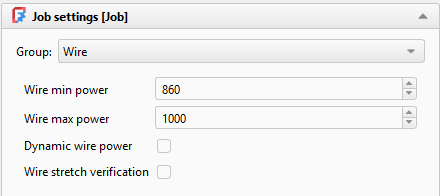

### Kerf compensation

Every wire melts the foam in all directions, so the cut has its width. Sometimes it's critical to have the exact size of a part, so we need to compensate for the kerf.
Kerf compensation value is a 1/2 of the cut width. It's a base value that could be measured in practice using the following steps:

- take a piece of the same foam your part will be cut from and experimentally dial the feed rate so you are satisfied with the cut quality
- measure foam thickness as precisely as you can
- create a job with a single route that will cut this piece into top and bottom pieces
- run the job
- put top and bottom pieces together and measure thickness again
- subtract the resulting thickness from the initial one -> it's your measured kerf for specific foam at specific speed
- divide the result by 2 -> it's your base kerf compensation. It's a good idea to make it slightly larger so you'll have material to remove during sanding.

This base compensation value will be used in the Uniform kerf compensation mode and will be increased/decreased depending on the wire speed over a specific path segment in the Dynamic mode.
Compensation degree is used in Dynamic mode to dial-in the exact compensation proportion. It's a fine-tune setting, keep the default value if not sure.

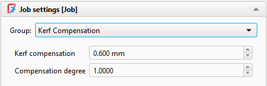

### Homing/Parking

When Homing is enabled, each G-code program starts with the homing command and after that the machine position is set to the provided values (G92).

When Parking is enabled, each program will start and end at the parking location. Useful when making multiple identical parts or to keep the wire out of the way when setting up or removing the workpiece.

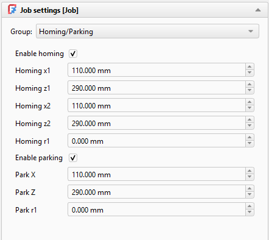

### G-Code

This section lets you set postprocessor settings:

- Feed rate mode - 2 modes supported, G94 and G93. G93 mode is the inverse time mode that gives your controller the exact time a particular move should take. It's the default mode for new Jobs and lets your machine keep a consistent speed across the whole route. G94 is easier, but since a foam CNC is a 4 axis machine it makes the speed calculation wrong every time you change direction. So it's not recommended to use G94 mode unless you know what you are doing.
- Time units - used for the Pause command (G04 Pxx). Different controllers expect different units. GRBL uses seconds, Linux CNC - milliseconds.
- Comment style - inline ";", block "()" or ignore (do not output) comments.
- Discretisation step - the output G-code is a number of straight segments. This setting sets the length of the segments a curved path will be broken into. It's a base value and can be slightly smaller or larger depending on the situation.
- Cut command - cut command (G01) format used in postprocessing.
- Move command - rapid travel. Can be substituted with G01 if your machine doesn't support rapids or you want more control over the rapid feed rate (most controllers ignore the F-word on G00 command and use an internal setting for the rapid speed)
- Pause command - G04 for most controllers but can be replaced with Mxxx for Marlin based machines for example.
- Wire on/off commands - self explanatory. Can be ignored if you don't drive the wire from G-code.
- Homing command - $H in GRBL or any other controller specific homing command
- Init position command - when homing is used it's next after the homing command to store the position
- Start program code - optional preamble - run before any line of G-code produced by the postprocessor. Could be custom comments or a specific homing cycle (do not forget to turn off Homing!) or anything else.
- End program code - ending code that runs after the postprocessor completes its output. Can be a wire cleaning cycle or a custom parking cycle or a comment or whatever.

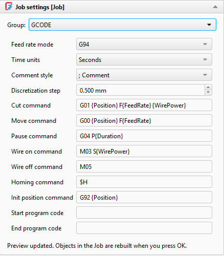

## Scripting the workbench

Every tool is a thin wrapper around a Python object factory, so the whole workflow can be reproduced from the FreeCAD Python console, a macro or `FreeCADCmd` without opening a single task panel. Each command module exposes a `create*` function:

| Object | Module | Factory |
| --- | --- | --- |
| Path | `WirePath` | `createPath(job, left_edge, right_edge)` |
| Projection | `WireProjection` | `createProjection(job, source)` |
| Move | `WireMove` | `createMove(job, start)` |
| Join | `WireJoin` | `createJoin(job, start, end)` |
| Enter | `WireEnter` | `createEnter(job, entry)` |
| Exit | `WireExit` | `createExit(job, exit)` |
| Rotation | `Rotate` | `createRotation(job, source)` |
| Route | `WireRoute` | `createRoute(job, objects)` |
| Duplicate route | `WireRouteClone` | `createRouteClone(job, source_route)` |

All factories follow the same convention:

- the first argument is the `Job` object that will own the new object;
- optional `label` sets the object label, the internal name stays `Path`, `Route`, ...
- optional `recompute` (default `True`) recomputes the document, pass `False` while building a chain and recompute once at the end;
- the created object is returned, so it can be configured further.

Geometry references are ordinary FreeCAD `LinkSub` values - a `(object, "Edge3")` pair. Subelement names are the usual FreeCAD ones: `Edge1`, `Vertex2`, `Face3`.

Two rules are easy to trip over:

- **Enter and Exit attach to movement objects, not to the model.** Their point link has to reference a vertex of a Path, Projection, Move or Join object, so the movement object must exist first.
- **A route consumes its objects.** `createRoute` removes the objects from the Job group; they stay in the document and are reachable through `route.Objects` (the route claims them in the tree view). Deleting the route puts them back into the Job.

All machine and process settings live on the Job. Children follow them through expressions where it matters (`obj.ExpressionEngine` shows entries like `('.SafeHeight', '._Job.SafeHeight')`), for example safe height, kerf compensation, the discretisation step and the feed rate/wire power of Move and Join; the remaining defaults (cut feed rate, wire power) are read by the postprocessor when the G-code is generated. Changing a Job value and recomputing therefore updates every object that has not been overridden. `utilities.overrideProperty(obj, "Prop", value)` detaches a single object from the Job value, `utilities.restorePropertyExpression(obj, "Prop", utilities.jobExpression(job, "Prop"))` binds it back, and `utilities.clearPropertyExpression(obj, "Prop")` drops the expression while keeping the current value.

### Build a complete job from a script

The example below creates a Job, a blank, a path across the middle of the block, the enter/exit moves and a route, then generates the G-code. It uses only the public factory functions, so steps 1-5 also run under `FreeCADCmd` (step 6 opens the G-code save dialog and therefore needs the GUI).

```python
import FreeCAD as App
import InitMachine
import WirePath, WireEnter, WireExit, WireRoute

doc = App.ActiveDocument or App.newDocument("Foamcut")

# - 1. Job: owns the machine geometry and every process setting
job = doc.addObject("App::DocumentObjectGroupPython", "Job")
InitMachine.Machine(job, job.Name)
if App.GuiUp:
    import MachineGui
    MachineGui.MachineVP(job.ViewObject)      # draws the machine in the 3D view

job.FieldWidth = 400       # distance between the wire planes
job.HorizontalTravel = 600
job.VerticalTravel = 300
job.BlockWidth = 400
job.BlockLength = 300
job.BlockHeight = 60
job.BlockPosition = App.Vector(-200, 150, 20)

# - 2. Profile body: its top edge is the line the wire follows
blank = doc.addObject("Part::Box", "Blank")
blank.Length = 400         # X - spans both wire planes
blank.Width = 300          # Y - along the block
blank.Height = 30          # Z - lower half of the block
blank.Placement.Base = App.Vector(-200, 150, 20)
doc.recompute()

def edge_link(obj, x, z):
    '''LinkSub of the horizontal edge that lies on plane X at height Z.'''
    for index, edge in enumerate(obj.Shape.Edges, start = 1):
        points = [vertex.Point for vertex in edge.Vertexes]
        if all(abs(p.x - x) < 1e-6 and abs(p.z - z) < 1e-6 for p in points):
            return (obj, "Edge{}".format(index))
    raise ValueError("no edge on X={} at Z={}".format(x, z))

def vertex_link(obj, point, tolerance = 1e-3):
    '''LinkSub of the obj vertex that coincides with point.'''
    for index in range(1, len(obj.Shape.Vertexes) + 1):
        name = "Vertex{}".format(index)
        vertex = obj.getSubObject(name)
        if vertex is not None and vertex.Point.distanceToPoint(point) < tolerance:
            return (obj, name)
    raise ValueError("{} has no vertex at {}".format(obj.Label, point))

# - 3. Path between 2 opposite edges, one edge on each wire plane
path = WirePath.createPath(job,
                           edge_link(blank, -200.0, 50.0),
                           edge_link(blank,  200.0, 50.0),
                           label = "Mid cut")

# - 4. Plunge down at the start and up at the end of the cut
enter = WireEnter.createEnter(job, vertex_link(path, path.Path_L[0]), label = "Enter")
exit_path = WireExit.createExit(job, vertex_link(path, path.Path_L[-1]), label = "Exit")

# - 5. Route in cut order: Enter -> Path -> Exit
route = WireRoute.createRoute(job, [enter, path, exit_path], label = "Mid cut route")

route.CompensationStrategy = "Dynamic"    # "None", "Uniform" or "Dynamic"
route.CompensationDirection = "Normal"
job.KerfCompensation = 0.4                # the route reads it from the Job
doc.recompute()

# - 6. G-code: writes the file you pick in the save dialog
import Postprocess
Postprocess.Postprocess().makeGCODE([route], job)
```

### Reuse the current selection

The helpers used by the GUI commands are public too, so a macro can act on whatever is selected in the 3D view:

```python
import FreeCAD as App
import WirePath
from utilities import getAllSelectedEdges

job = App.ActiveDocument.getObject("Job")
edges = getAllSelectedEdges()          # [(obj, ["Edge3"]), (obj, ["Edge5"])]
if len(edges) == 2:
    path = WirePath.createPath(job, edges[0], edges[1], label = "From selection")
```

`getAllSelectedObjects()` returns the selected sub-objects in the same `(object, [name])` form, which is what Enter, Exit, Move and Join expect, and `getEdgesLinks(obj, face)` turns a selected face into a list of edge links for the "path from 2 faces" workflow.

### Duplicate a route

`createRouteClone` follows the source route, and `setRoutePosition` validates the placement against the working area before it is applied:

```python
import FreeCAD as App
import WireRouteClone

doc = App.ActiveDocument
job = doc.getObject("Job")
source = doc.getObjectsByLabel("Mid cut route")[0]

# - one mirrored copy: YZ swaps the wire profiles, XY flips it about block mid-height
mirror = WireRouteClone.createRouteClone(job, source, label = "Mirrored copy")
WireRouteClone.setRoutePosition(mirror, App.Vector(0, 0, 0), "YZ")

# - a row of copies placed along machine Y
for row in range(1, 3):
    clone = WireRouteClone.createRouteClone(job, source,
                                            label = "Part {}".format(row),
                                            recompute = False)
    WireRouteClone.setRoutePosition(clone, App.Vector(0, row * 100, 0))
```

The mirror modes are `"None"`, `"YZ"`, `"XY"` and `"YZ+XY"`. Only original routes can be cloned (a clone of a clone is rejected), the source must belong to the same Job, and `setRoutePosition` raises instead of moving a route out of the working area, leaving the previous position untouched.

### Change settings and inspect the result

```python
import FreeCAD as App
import utilities, WireRoute

doc = App.ActiveDocument
job = doc.getObject("Job")
route = doc.getObjectsByLabel("Mid cut route")[0]

# - Job values drive the objects: through expressions (safe height, kerf,
#   feed of Move/Join) or at export time (cut feed rate, wire power)
job.FeedRateCut = 2.0
job.KerfCompensation = 0.5

# - Detach one object from its Job default and give it a literal value
for obj in route.Objects:
    if obj.Type == "Enter":
        utilities.overrideProperty(obj, "SafeHeight", 150.0)

doc.recompute()

# - Map the flattened route points back to the objects that produced them
for obj, start, count in WireRoute.getRoutePointLayout(route):
    print("{:<11} {:>3} points starting at index {}".format(obj.Type, count, start))
```

`WireRoute.getRoutePointLayout` pairs each route element with its index range in `route.Offset_L` / `route.Offset_R`, which is the reliable way to find a specific point (for example the end of a cut) without hard-coding indices. It raises if the route layout no longer matches its points, which means the route needs a recompute.

### 5 axis routes

A rotation only happens between two cuts, so a 5 axis route is one route split by rotations: `Exit -> Rotation -> Enter`, repeated as many times as needed. A `Rotation` must be preceded by an `Exit` (or be the first object) and followed by an `Enter` (or be the last one); a route cannot start with an `Exit` and cannot end with an `Enter`. `enter_1`, `path_1`, ... below stand for objects built as in the complete example:

```python
import Rotate, WireRoute

rotation = Rotate.createRotation(job, blank, label = "Turn 90")
rotation.Angle = 90

route = WireRoute.createRoute(job, [enter_1, path_1, exit_1,
                                    rotation,
                                    enter_2, path_2, exit_2],
                              label = "5 axis cut")
```

### Errors and validation

Movement factories (`createPath`, `createEnter`, `createJoin`, ...) build their geometry immediately. When that fails the factory deletes the half-built object and re-raises, so a `try/except` in the calling script catches the error.

A route is built during the document recompute, so its own validation is reported by FreeCAD instead: an invalid order or a point outside the working area ("horizontal/vertical travel exceed machine boundary ... Adjust model position") shows up in the report view prefixed with the route label, and the route keeps its previous points (a new route has none). Check `if not route.Offset_L:` after the recompute, fix the cause, then `route.touch()` and recompute again. The same rule covers Enter/Exit objects whose parent movement object was deleted.

Only two things really need the GUI: the task panels (`MachineGui.showJobPanel(job)`, `MovementGui.showMovementPanel(obj)`, `RouteGui.showRoutePanel(route)`, `RotationGui.showRotationPanel(rotation)`) and the G-code save dialog used by `Postprocess.makeGCODE`. Everything else is plain document data.

## Limitations/TODO

 - ~~Machine setup is not parametric. Path and other objects will not be recalculated if you change working area in the middle of the process. But objects themselves are parametric and will be recalculated in case target body parameters got changed.~~ DONE
 - ~~There should be only one machine per file. So far objects strongly depend on that.~~ DONE
 - ~~Need to add foam block representation in setup.~~ DONE
 - ~~5th axis location not configurable for now~~ DONE
 - ~~Machine origin is hardcoded and locates in a working area center~~ DONE
 - ~~No kerf settings. User can overcome it by modifying model (create Draft offset and use it as reference for paths )~~ DONE
 - ~~It's highly recommended to export your model as a .STEP file, import it into a new document and start from there. Since all objects depend on the underlying geometry, in most cases you cannot transform your model or part of it to place it inside the working area. It's a higher priority TODO.~~ DONE with some limitation
 - ~~Cannot create path by selecting faces. In many cases it could be very useful to just select 2 faces and create path/route based on their edges (somewhat like loft) instead of selecting edges one by one.~~ DONE
 - ~~Configuration setup panel widget~~ DONE
 - ~~Make helper geometry unpickable~~ Done
 - ~~G93 mode~~ DONE: new `FeedRateMode` setting in the machine config (GCODE group). G94 = mm/min (default for existing documents); G93 = inverse time feed rate (default for new documents), where the physical cutting speed stays synchronized with the wire temperature-dependent kerf. In G93 the postprocessor converts every cut/rapid/rotation feed to inverse time and emits `G94`/`G93` mode switches automatically.
 - ~~mirroring gcode tool~~ DONE
 - ~~Create path by vertex and edge~~ Done
 - ~~Edge projection normal to the working plane~~ DONE
 - ~~Toggle projection lines~~ DONE
 - ~~Add package.xml~~ DONE
 - Automatically place model inside machine and create foam block around it. Right now it's recommended to create a parametric copy of your model (like Draft.Clone) after placing model where you want, to reset model placement.
 - Add video tutorial
 - Add examples
 - and many more I forgot for sure ;) 
 
## Discussion
Please offer feedback or connect with the developer via the [dedicated FreeCAD forum thread](https://forum.freecad.org/viewtopic.php?style=10&t=91419).

## License
GNU Lesser General Public License v2.1
