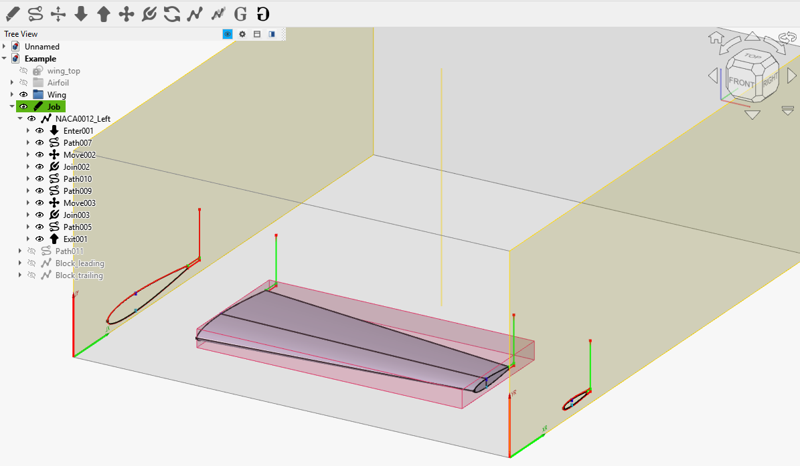
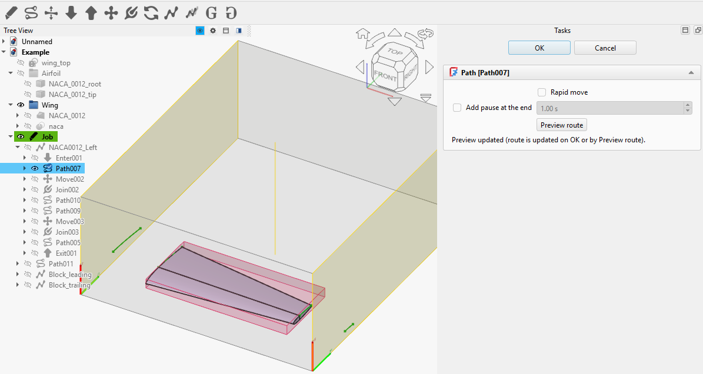
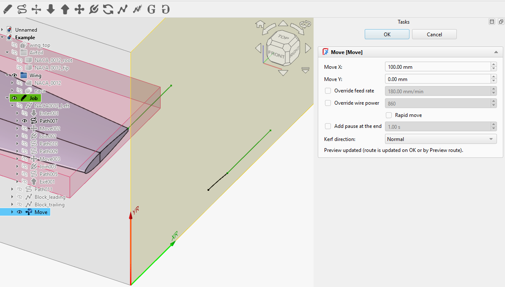
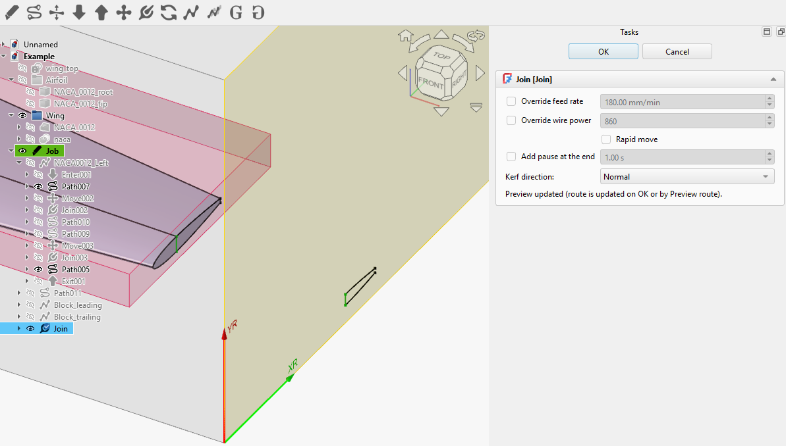
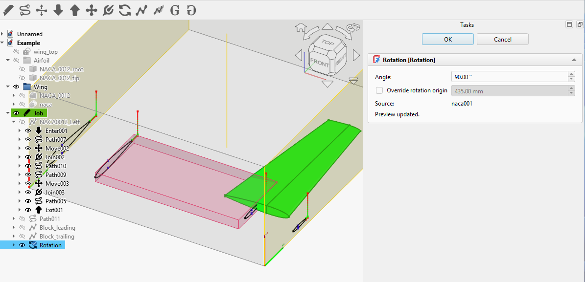

# FoamCut Workbench



A FreeCAD External Workbench for creating Gcode for 4 and 5 axis CNC foam cutting machine.

Originally it based on set of macros written by Andrei Bezborodov (HardRock) - member of FreeCad community. His idea was build 5 axis foam cutter and use FreeCad as a platform to produce output for this machine. Since he has no time to continue development further I decided to step in. Hopefully our effort will be appreciated. 

So far there are many limitation but I'm working on fixes.
If you want to contribute to this project - you highly welcome!
Enjoy!

## Installation

### Automatic Installation via Addon Manager (Recommended)

- Open Tools > Addon Manager

- Search for FoamCut and click install.

<details><summary>Expand for details regarding Manual installation</summary>

### Manual Installation via Git

Linux:
```bash
cd ~/FreeCAD/Mod/ 
git clone https://github.com/Shkolik/Foamcut.git
```

Windows:
```bash
cd %APPDATA%\FreeCAD\Mod 
git clone https://github.com/Shkolik/Foamcut.git
```

### Manual Installation via Zip

- Go to https://github.com/Shkolik/Foamcut
- Click on Code > Download ZIP
- Extract content of ZIP archive to your Mod directory

Linux:
```
~/FreeCAD/Mod/
```

Windows:
```
%APPDATA%\FreeCAD\Mod 
```

</details>

When you restart FreeCAD, "FoamCut" workbench should now show up in the [workbench dropdown list](https://freecadweb.org/wiki/Std_Workbench).

## Video Tutorial

Quick workflow example:
[FoamCut workflow](https://youtu.be/15t2KHbIPVY)

Old tutorials (using macro), but workflow is the same (in Russian).
[ЧПУ пенорезка на 5 осей. Подготовка задания в FreeCAD.](https://youtu.be/TuBmqCTIS20?si=CNeAytixMs9086Nn) 

## Example file

[Example file to play with workbench](Examples/Example.FCStd)

## Tools
###  Init Machine
Creates the Job object and opens the Job settings task panel. The panel groups every machine and process setting into pages (machine geometry, foam block, travel, axis mapping, feed rates, wire, kerf compensation, homing/parking and G-code). Values use the preferred unit system; dependent settings appear when their option is enabled (for example the homing positions once "Enable homing" is checked). All objects in the Job are rebuilt when the panel is closed with OK, and Cancel restores the previous setup (or removes a freshly created Job). Double-click the Job to edit the settings again. The Job itself cannot be picked in the 3D view: its machine graphics are drawn inline and are never painted in the selection color (selecting the Job shows only a bounding box, and opening the panel clears the selection).


###  Create path
Creates path by 2 given opposite edges. Opposite faces also supported - command will try to find opposite edges and create a path for each edge pair. 



###  Create projection
Creates projection path from selected single edge, multiple edges or face. Projection is basically emulation of 2 axis macine with 4 axis. Can be used for preparing foam blocks, cutting "hershi-bar" wings or decorative signs.
Projection and Path objects cannot be mixed in a same route. Command will create projection for each edge. 


###  Create move path
Creates path from selected vertex in specified direction



###  Join
Creates path between 2 selected vertices



###  Enter
Creates enter path from safe height to selected vertex


###  Exit
Creates exit path to the safe height from selected vertex


###  Rotation
Rotate selected body around 5th axis



###  Route
Creates a cutting route from selected paths and rotations. Objects should be selected in a right order before executing command.
Kerf compensation currently supported and kerf direction can be specified for each object (except Rotation, Path and Projection) independently or for whole route.


###  Duplicate route
Creates a parametric clone of the selected route and opens a task panel to place and mirror it. The clone follows all changes of the source route (paths, kerf compensation, pauses, feed overrides). The panel sets a Y (block length) and Z (block height) offset relative to the source, mirrors the cut horizontally (YZ) by swapping the wire planes like Mirror GCODE does, and can mirror it vertically (XY) about the middle of the foam block. In XY mode the plunge moves always stay at safe height and lead-in/lead-out are rebuilt from the mirrored entry/exit point, so their approach angle stays correct. Rotation angles are reversed for any mirror. Double-click a clone to edit it again. Only original routes can be duplicated - a clone cannot be cloned.

Scripts can create a clone without the GUI:

```python
import WireRouteClone
job = FreeCAD.ActiveDocument.getObject("Job")
route = FreeCAD.ActiveDocument.getObject("Route")
clone = WireRouteClone.createRouteClone(job, route)
```

###  Generate Gcode
Generates Gcode and save it to the specified file

###  Mirror Gcode
Mirror selected GCODE file around YZ plane. Useful for cutting symmetrical pieces like wing consoles. At the moment there is no validation or changing metadata in resulted files - be careful using this command.

## Limitations/TODO

 - ~~Machine setup is not parametric. Path and other objects will not be recalculated if you change working area in a middle of the process. But object themself parametric and will be recalculated in case target body parameters got changed.~~ DONE
 - ~~There should be only one machine per file. So far objects strongly depends on that.~~ DONE
 - ~~Need to add foam block representation in setup.~~ DONE
 - ~~5th axis location not configurable for now~~ DONE
 - ~~Machine origin is hardcoded and locates in a working area center~~ DONE
 - ~~No kerf settings. User can overcome it by modifying model (create Draft offset and use it as reference for paths )~~ DONE
 - ~~It's highly recommended to export your model as .STEP file, import it in new document and start from there, or . Since all objects depends on underlying geometry you, in most cases, cannot transform your model or part of it to place inside working area. It's higher priority TODO.~~ DONE with some limitation
 - ~~Cannot create path by selecting faces. In many cases it could be very useful to just select 2 faces and create path/route based on their edges (somewhat like loft) instead of selecting edges one by one.~~ DONE
 - ~~Configuration setup panel widget~~ DONE
 - ~~Make helper geometry unpicable~~ Done
 - ~~G93 mode~~ DONE: new `FeedRateMode` setting in the machine config (GCODE group). G94 = mm/min (default for existing documents); G93 = inverse time feed rate (default for new documents), where the physical cutting speed stays synchronized with the wire temperature-dependent kerf. In G93 the postprocessor converts every cut/rapid/rotation feed to inverse time and emits `G94`/`G93` mode switches automatically.
 - ~~mirroring gcode tool~~ DONE
 - ~~Create path by vertex and edge~~ Done
 - ~~Edge projection normal to the working plane~~ DONE
 - ~~Toggle projection lines~~ DONE
 - ~~Add package.xml~~ DONE
 - Automatically place model inside machine and create foam block around it. Right now it's recommended to create a parametric copy of your model (like Draft.Clone) after placing model where you want, to reset model placement.
 - Add video tutorial
 - Add examples
 - many more I forgot for sure ;) 
 
## Discussion
Please offer feedback or connect with the developer via the [dedicated FreeCAD forum thread](https://forum.freecad.org/viewtopic.php?style=10&t=91419).

## License
GNU Lesser General Public License v2.1